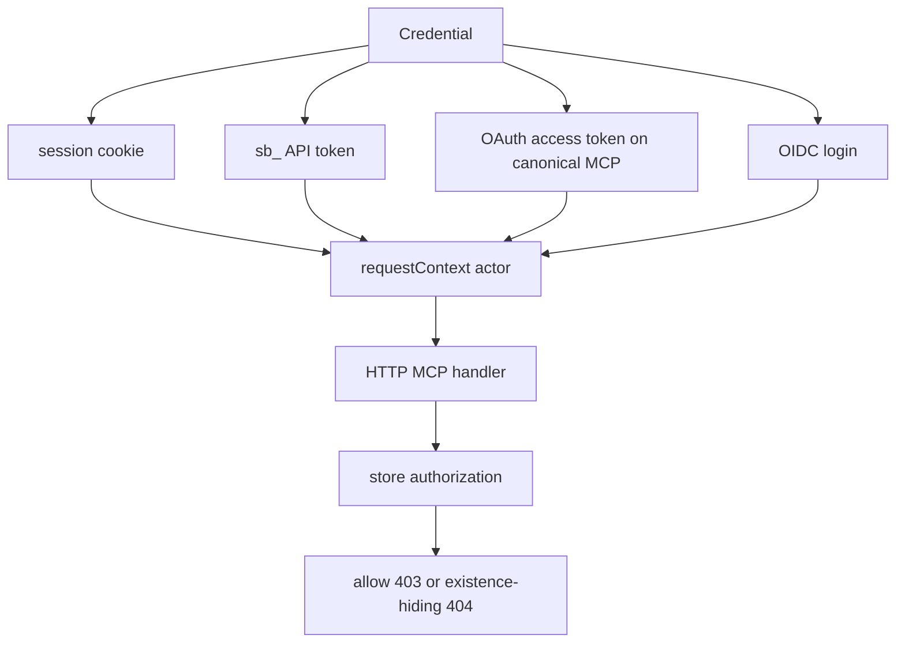
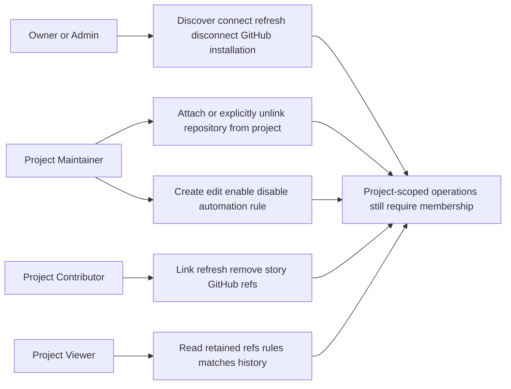
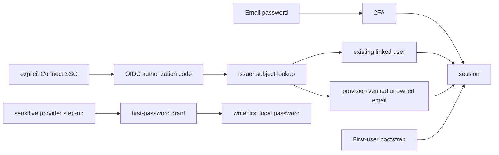

# Authentication and permissions

Scrumboy separates **instance-wide system roles** from **per-project roles**. HTTP establishes identity; transaction-authoritative store methods decide access.

## System roles

| Role | Instance authority |
|---|---|
| Owner | user administration, role assignment, owner-only sensitive setup such as guided GitHub App enrollment |
| Admin | instance administration allowed by admin APIs, including GitHub installation management |
| User | no instance-wide administration |
| Guest | assigned regular boards are read-only; temporary-board collaboration by shared link remains possible; cannot create/import/claim boards |

System roles **never grant project membership**.

## Project roles

| Role | Project authority |
|---|---|
| Viewer | read project/story state and retained integration references |
| Contributor | limited project mutations, including allowed reference/tag operations; body edit only when assigned under normal story rules |
| Maintainer | project configuration, members, full story management, repository association and automation rule management |

Temporary/anonymous boards use separate link/expiry semantics and do not expose durable-project integration surfaces.

## GitHub authority composition

An instance Owner/Admin cannot bypass project membership merely because they control the GitHub App. Conversely, project membership never exposes App private keys, webhook secrets or installation tokens.

## Login paths

Normal OIDC login never silently links by email and never rewrites the canonical user email. Sensitive local-password establishment for an SSO-only account uses a separate step-up and short-lived session-bound grant.

See [roles-and-permissions.md](../roles-and-permissions.md) for the complete matrix.
