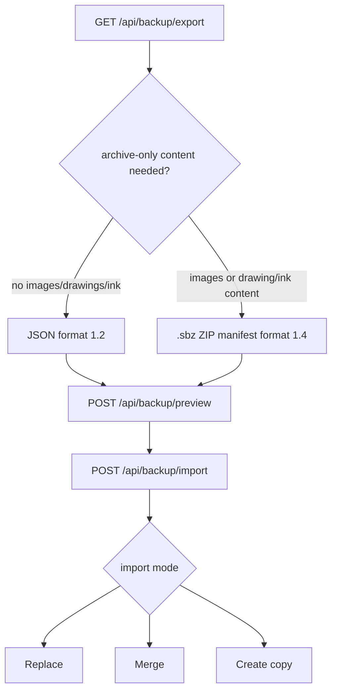
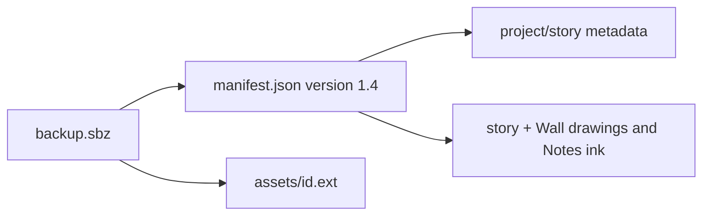
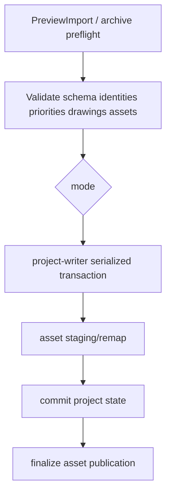
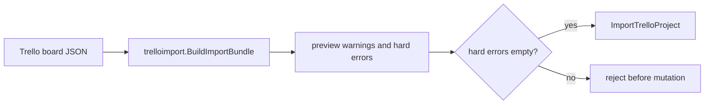

# Backup and import

Scrumboy has two backup layers:

1. **Logical project export/import** through Settings/API.
2. **Whole-instance filesystem backup** of DATA_DIR plus external secrets for disaster recovery.

This page covers the logical layer. See `scrumboy_deployment_ops.md` for full-instance recovery.

JSON format 1.2 carries portable project/story state such as workflow, tags, priorities, archive state, due dates, custom fields and related project content. Publication state is intentionally not transferred.

Archive format **1.4** is used when archive-only content must travel with the project. It can include:

- inline note images under `assets/`
- standalone/story drawing data
- Wall drawing data
- Notes ink

Older archive 1.3 remains readable as a legacy image archive, but it cannot represent the drawing/ink additions introduced in 1.4.

## Archive structure

Imported image IDs are remapped and embedded note destinations are rewritten only where they represent Scrumboy-managed images. Merge can reuse identical target-project bytes. Import preflight rejects incomplete/corrupt archives before committing project state.

Replace, Merge and Create copy preserve the existing mode semantics. Replace requires explicit confirmation and must not leave the database half-mutated if asset restoration fails.

## Native import flow

## Trello import

Trello JSON uses its own conversion pipeline and does not share the generic native import transform.

Closed Trello cards become archived Scrumboy stories; closed lists are a separate concept and retain their closed-list labeling/mapping. Trello members are preserved as import context rather than silently becoming Scrumboy assignees.

Logical project imports do not restore host-level GitHub credentials, wallpapers, instance audit state, or encryption secrets.
