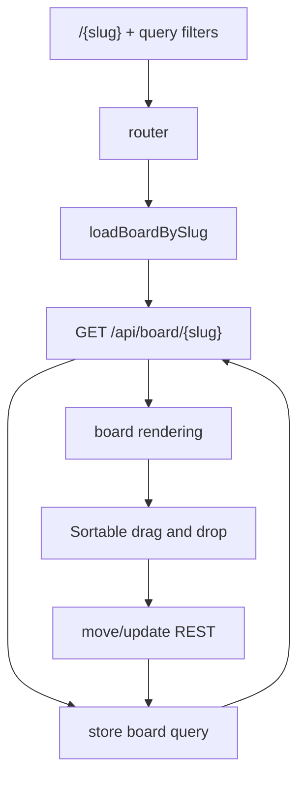
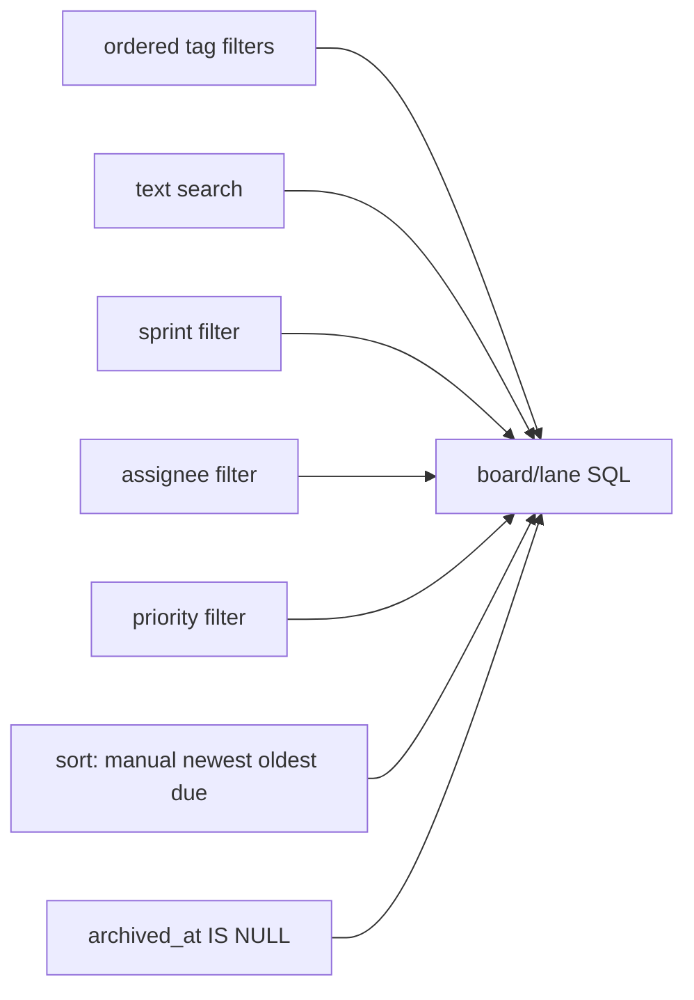
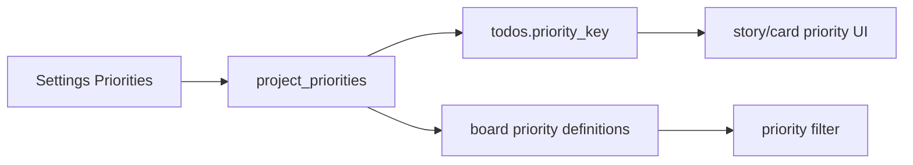
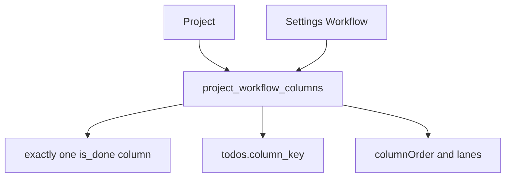
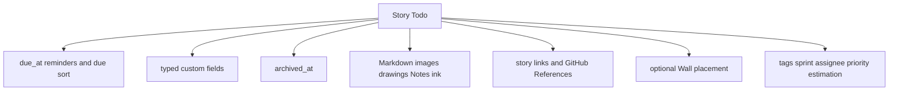

# Board and Kanban UX

Board state is loaded by slug, filtered and sorted server-side, then rendered into project-defined workflow lanes. Active-board reads exclude archived stories.

## Board query state

The SPA preserves filter/sort state in the board URL. Large boards can fall back to per-lane pagination using cursors that match the selected sort order. Due-date sorting places undated stories after dated ones.

## Priority tiers

Each durable project owns ordered `project_priorities` definitions with stable keys, names, colors and positions. Todos hold an optional project-local `priority_key`.

Maintainers manage priority tiers and assign/clear story priorities. Viewers can read the definitions and filter the board by a specific tier or no priority.

## Workflow columns

Projects can add, rename, recolor and reorder up to the supported workflow-column limit, and choose the lane that counts as done. Todos reference stable column keys rather than a hard-coded status enum.

## Story state beyond lanes

Archive/restore removes a story from ordinary board queries without hard-deleting it. The archive has its own listing route. GitHub repository and issue/PR references are separate from title/body/workflow state and do not automatically move or edit a story.

See `scrumboy_github_integration.md` for external-reference authority and `scrumboy_wall_canvas.md` for Wall placements.
