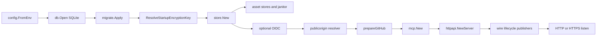
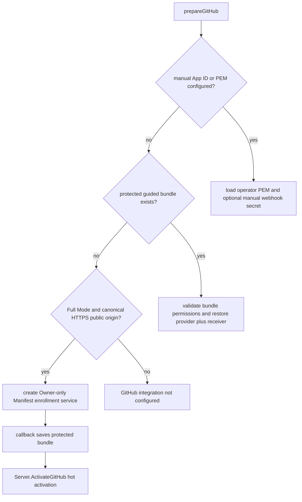
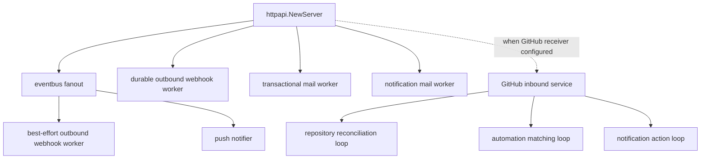

# Application bootstrap

Startup in `cmd/scrumboy/main.go` builds persistence and security prerequisites before opening the HTTP listener.

`prepareGitHub` has three paths:

Manual App settings take precedence over a saved guided bundle without rewriting it. Guided credentials must pass platform privacy validation before startup continues.

## Server workers

The GitHub service owns its own bounded polling/lease loop and is not the same worker as Scrumboy's outbound project-webhook dispatcher.

## Periodic maintenance

The main hourly maintenance covers temporary-project expiry, OAuth artifact cleanup and WAL checkpointing. Other subsystems have their own bounded maintenance, including asset cleanup, durable outbound webhook maintenance, and GitHub inbound/automation retention.

## Shutdown

`http.Server.Shutdown` stops new HTTP work. `Server.Close` then seals/drains outbound delivery queues, stops mail workers, cancels the GitHub inbound service, and waits on worker completion subject to the shutdown context. The server marks GitHub runtime activation closed so a late Manifest callback cannot start a new provider worker during shutdown.
