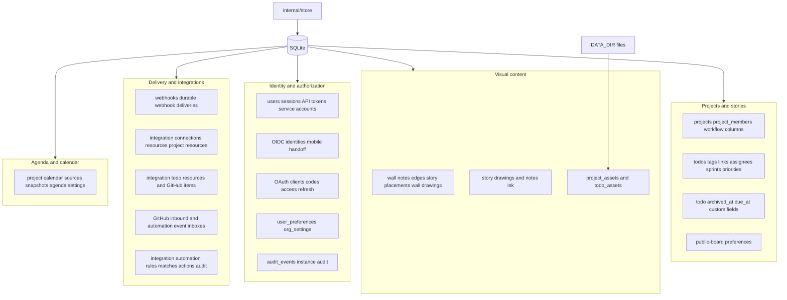
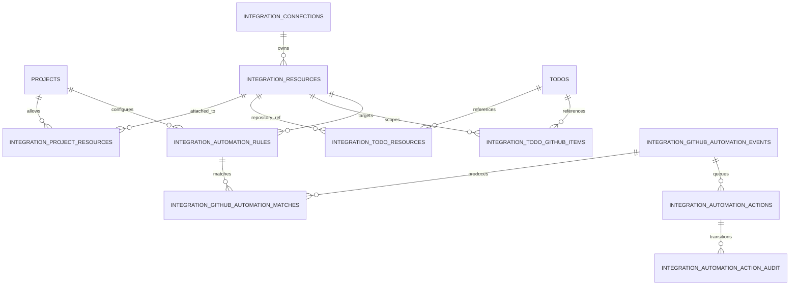
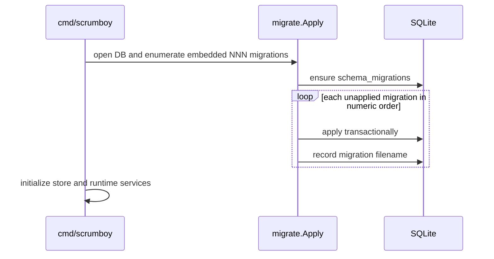

# Data model and persistence

SQLite is the authoritative store for board, identity, permissions, integration metadata and durable work queues. File-backed state under `DATA_DIR` holds uploaded images, wallpapers, and the optional guided GitHub credential bundle.

## Integration relationships

`integration_resources.availability` is independent of repository identity. A complete GitHub scan can mark a repository `unavailable` while keeping its stable provider ID, project associations and existing story references.

The inbound GitHub tables store delivery metadata and payload digests, not raw webhook JSON or provider credentials. Guided App private keys and webhook secrets are outside SQLite in the protected credential bundle.

## Migration pipeline

As of v3.43.0 the embedded schema reaches **migration 100**. Important later groups include:

| Range | Major additions |
|------|------------------|
| 065-070 | Agenda/calendar sources, snapshots and mobile OIDC handoff |
| 071-079 | Story archival, service-token groundwork, Wall story placement, public boards, due dates, inline assets, custom fields |
| 080-086 | Service accounts, instance auditing, webhook provenance and bounded durable outbound delivery |
| 087-089 | Story drawings, Wall drawings and Notes ink |
| 090-091 | Guest system-role membership restrictions and temporary-board semantics |
| 092-096 | Provider-neutral integration foundation, story repository links, GitHub inbound inbox, resource availability, structured GitHub issue/PR references |
| 097-100 | Automation rules, GitHub automation events/matches, durable actions/audit, single-toggle enable semantics |

Migration discovery has no hard-coded upper bound. PR #366 retains alias handling for earlier staging-only integration migration filenames so a previously exercised test database does not replay the renumbered 092-100 series.

## Authorization facts

- Store methods, not only HTTP handlers, enforce system/project role boundaries.
- System roles and project roles are separate.
- Historical attribution fields such as `created_by_user_id` do not grant access.
- Public-board reads use isolated projections and do not expose private integration management surfaces.
- Service-account provenance and Guest role state do not silently expand project authority.
