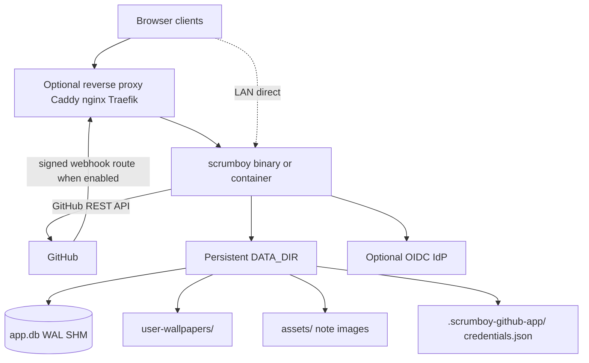
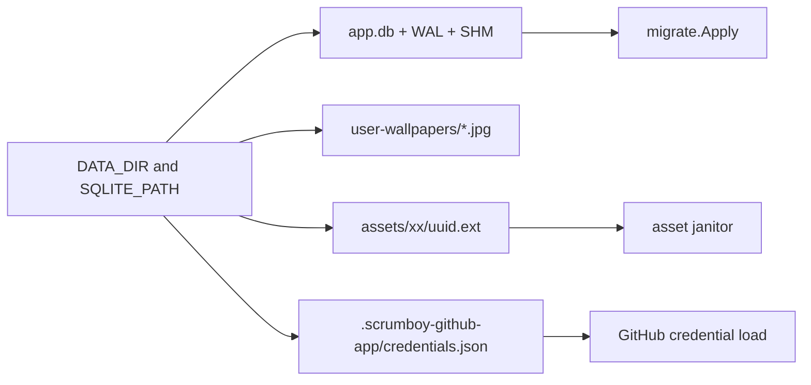
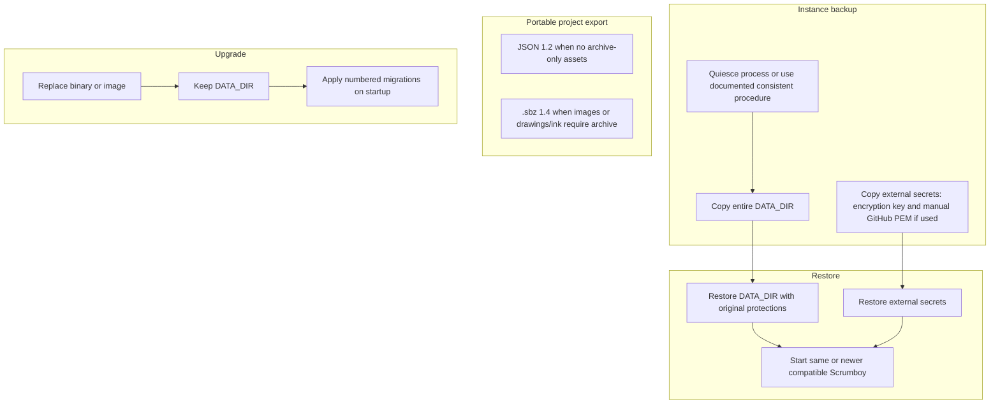

# Deployment and operations

Single-node self-hosting: one Scrumboy process, one SQLite database, one persistent `DATA_DIR`. No built-in clustering or HA; do not run multiple writers against the same database.

## Typical topology

A public reverse proxy is optional for ordinary Scrumboy use. It becomes necessary for GitHub real-time events unless the app itself is directly reachable on public HTTPS. Expose the exact `/api/integrations/github/webhook` route; a private Tailscale-only address cannot receive direct GitHub deliveries.

- **Docker:** use `ghcr.io/markrai/scrumboy:latest`, publish the application port, and mount persistent storage on `/data`.
- **TLS:** terminate at a reverse proxy or configure `SCRUMBOY_TLS_CERT` plus `SCRUMBOY_TLS_KEY`.
- **Bind:** `BIND_ADDR` defaults to `:8080`.
- **Public origin:** guided GitHub App enrollment and several URL-generating features require a canonical HTTPS `SCRUMBOY_PUBLIC_BASE_URL`.

## Persistence under DATA_DIR

SQLite stores board/auth/domain state, including Wall drawings, Notes ink, GitHub integration metadata, webhook inboxes, automation rules/actions, and audit records. Uploaded wallpapers and note images are file-backed. Guided GitHub App secrets are also file-backed but deliberately live **outside SQLite**.

### Persistence matrix

| State | Location | In logical project export | Needed for full instance restore |
|-------|----------|---------------------------|----------------------------------|
| SQLite | `SQLITE_PATH` | scoped project data only | yes |
| WAL/SHM | beside SQLite | no | quiesce/checkpoint or copy consistently |
| Wallpapers | `DATA_DIR/user-wallpapers/` | no | yes |
| Note images | `DATA_DIR/assets/` | in `.sbz` when referenced by exported stories | yes |
| Story/Wall drawings and Notes ink | SQLite | `.sbz` format 1.4 | yes |
| Guided GitHub App credentials | `DATA_DIR/.scrumboy-github-app/credentials.json` | no | yes if guided GitHub identity must survive |
| Manual GitHub App PEM | operator-managed secret path | no | yes if manual GitHub setup is used |
| `SCRUMBOY_ENCRYPTION_KEY` | env/secret manager | no | yes when encrypted auth/calendar data exists |
| Mermaid docs override | `DATA_DIR/mermaid-semantic-edges.json` when used | no | only for that override |

Treat any backup containing `.scrumboy-github-app/` or a manual App PEM as a secret-bearing backup.

## Backup, restore, and upgrade

- **Full instance backup:** prefer a stopped/quiesced copy of all `DATA_DIR`, not only `app.db`. Follow [recovery.md](../recovery.md#instance-backup-and-restore) for a consistent online procedure when downtime is not practical.
- **Logical export:** JSON/`.sbz` project exports are useful for portability but omit instance credentials, users outside the selected project scope, wallpapers, audit state, and other host-level state.
- **GitHub guided identity:** restore the protected `.scrumboy-github-app` directory with private permissions. A permissive or corrupt bundle fails closed.
- **Upgrade:** replace the binary/image, preserve data/secrets, restart, and let migrations apply automatically.

## Operational limits

- SQLite is a single-writer database; one running Scrumboy process should own a database.
- Optional OIDC, SMTP, Web Push, public boards, MCP/OAuth, GitHub integration, outbound webhooks, Wall/drawing, Markdown/Mermaid and inline images add configuration but are not required for core board use.
- Repository browsing can work without GitHub webhooks. Real-time GitHub automations require provider reachability to the signed inbound endpoint.
