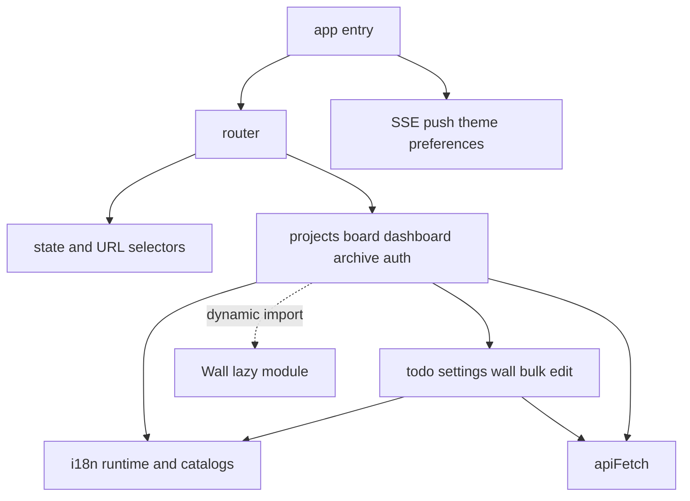
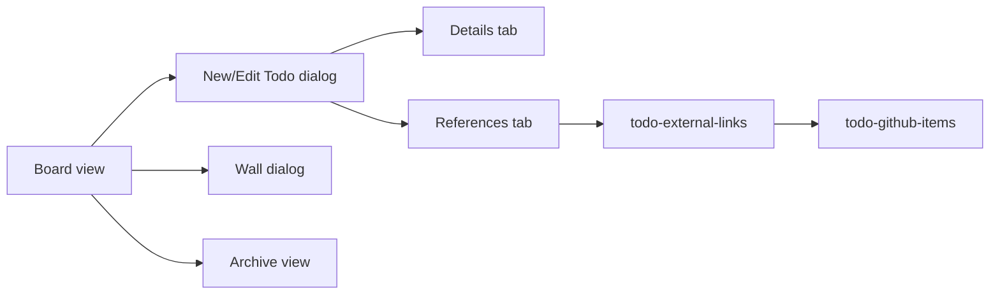
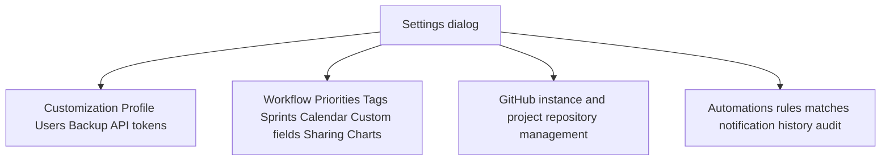
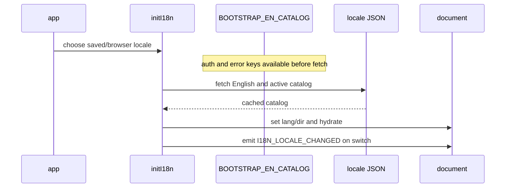

# Frontend SPA shell

The browser application is vanilla TypeScript compiled to `web/dist/` and embedded by the Go server. Large feature surfaces such as the Wall are loaded on demand.

## Board and story surfaces

The References tab is available on authenticated durable projects. It supports repository references and structured GitHub issue/PR references. GitHub browsing defaults to open pull requests, with repository/type/state selectors and a debounced title filter. New Todo can stage references before the story ID exists and commits them after creation.

Unavailable GitHub repositories retain cached references. The UI marks them unavailable and prevents new links until installation access is restored and repositories are refreshed.

## Settings composition

GitHub installation discovery is instance-admin oriented; repository association is project-scoped. Automations are readable by project members and mutable only by Maintainers.

## Locale flow

Public locale catalogs cover 23 languages; `pseudo` remains localhost/test QA only. RTL direction applies to Arabic, Urdu and Persian.

## Client routes

| Path | View |
|---|---|
| `/` | projects list in Full Mode; Anonymous Mode landing before SPA boot |
| `/dashboard` | dashboard |
| `/{slug}` | board |
| `/{slug}/t/{id}` | board with story open |
| `/{slug}/archive` | archived stories |
| `/auth/reset-password` | reset-password form |

Login/bootstrap/2FA use auth overlays rather than separate routes. Unmatched private-board/archive destinations that resolve to not-found return to the safe application root without weakening existence-hiding behavior.

Theme, density, board filter layout, board sort, VoiceFlow, notifications and Wall canvas preferences are browser/user-level frontend preferences layered over server-authoritative project permissions.
