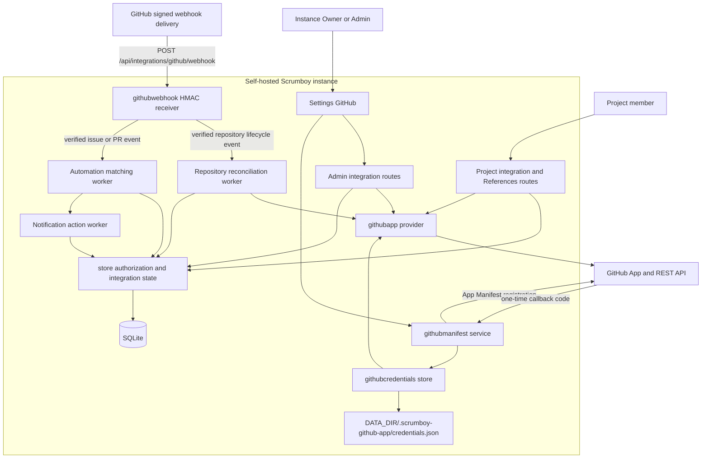
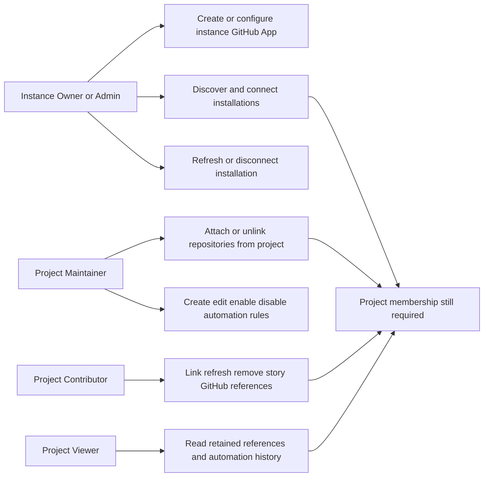
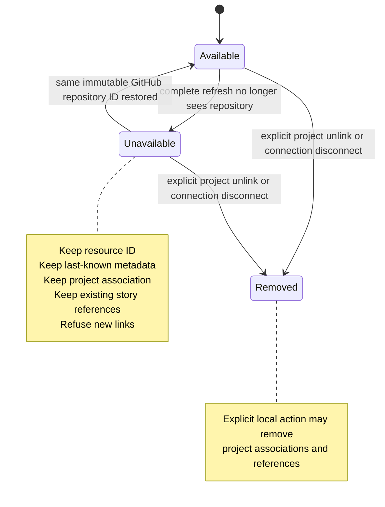
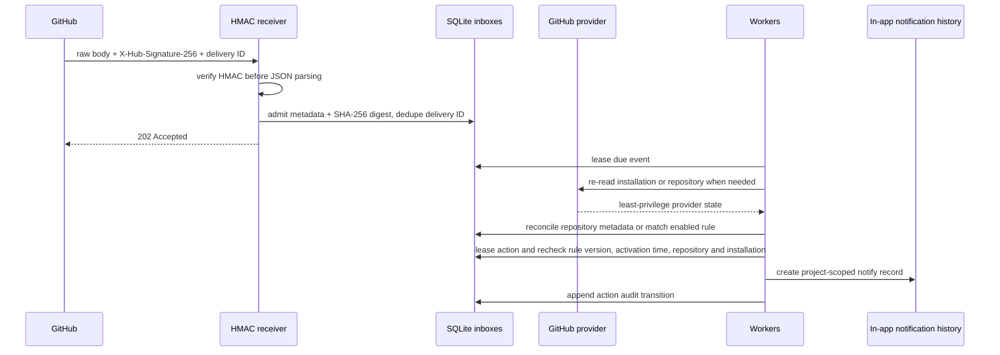

# GitHub integration architecture

Scrumboy v3.43.0 uses an **instance-owned GitHub App**. The self-hosted operator owns the App and its credentials; there is no Scrumboy.com relay, shared production App, or central broker in the data path.

## Authority split

System privilege does not grant project membership. An Owner/Admin who is not a member of a project cannot use project-scoped GitHub APIs merely because they administer the instance.

## Repository and reference lifecycle

A failed, partial, unauthorized, or truncated provider scan is **not** treated as an empty installation and does not destructively reconcile repositories.

## Signed inbound event path

Only the `notify` action executes in v3.43.0. It creates an in-app history record. It does not edit a Scrumboy story, write to GitHub, publish a board, send email, or generate Web Push.

## Credential boundary

Guided App setup stores one protected bundle under `DATA_DIR/.scrumboy-github-app/credentials.json`. POSIX mode and Windows DACL privacy are validated on load. Manual App configuration instead reads an operator-managed PEM path. SQLite never stores the App private key, webhook secret, installation access tokens, or JWTs.

See [GitHub App integration](../github-app.md), [GitHub inbound webhooks](../github-m4-webhooks.md), and [GitHub notification automations](../github-m5-automation.md).
