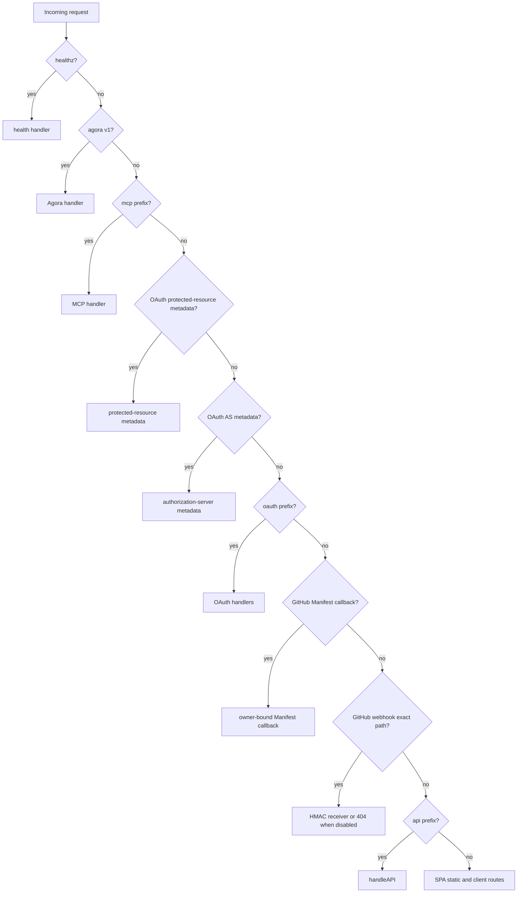
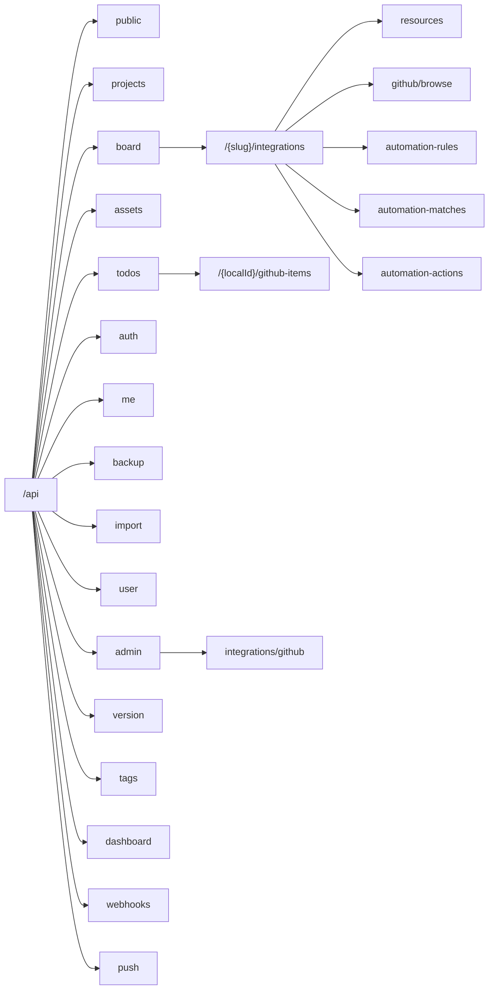

# HTTP request routing

Top-level dispatch in `internal/httpapi/server.go` keeps a few protocol surfaces outside the normal `/api/*` router.

Dispatch order is significant. The GitHub callback and webhook endpoint are intercepted **before** the generic API router. The webhook receiver therefore does not use browser-session CSRF semantics; it authenticates GitHub with `X-Hub-Signature-256` over the raw request body.

## API namespaces

Important GitHub routes include:

| Surface | Route | Authority |
|---|---|---|
| Guided registration start | `POST /api/admin/integrations/github/manifest/start` | instance Owner |
| Manifest callback | `/api/integrations/github/manifest/callback` | one-time Owner-bound state + GitHub code |
| Installation management | `/api/admin/integrations/github/*` | Owner/Admin |
| Signed provider webhook | `POST /api/integrations/github/webhook` | GitHub HMAC, not browser auth |
| Project repository association | `/api/board/{slug}/integrations/resources` | project-scoped |
| Issue/PR browse | `/api/board/{slug}/integrations/github/browse` | authenticated project member |
| Story GitHub refs | `/api/board/{slug}/todos/{localId}/github-items` | project-scoped |
| Automation rules/history | `/api/board/{slug}/integrations/automation-*` | project-scoped |

Normal state-changing `/api/*` browser requests require `X-Scrumboy: 1` except the documented auth exceptions. Public-board reads use the isolated `/api/public/*` namespace and do not expose private integration surfaces.

## SPA paths

- `/`: projects list in Full Mode; Anonymous Mode can serve the marketing landing
- `/dashboard`: personal dashboard
- `/{slug}`: canonical project board
- `/{slug}/t/{localId}`: story deep link
- `/{slug}/archive`: archived-story listing
- `/anon`: create temporary anonymous board and redirect
- `/temp`: redirect to `/anon`
- `/{locale}/`: localized Anonymous Mode marketing landing
- `/p/{id}`: legacy project redirect
- `/auth/reset-password`: reset-password form
- `sw.js`: version-injected service worker

See `scrumboy_github_integration.md` for the provider-specific flow.
