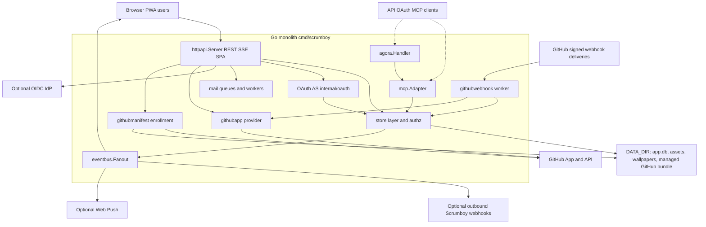

# Scrumboy system overview

Self-hosted project management in one Go process: embedded TypeScript SPA, REST, SSE, MCP, optional outbound delivery, and optional instance-owned GitHub integration, backed by SQLite and file-backed state under `DATA_DIR`.

The ordinary application path is browser → HTTP → store → SQLite, with SSE for live board refreshes. Optional integrations branch from that core but keep store authorization as the authority.

**Outbound Scrumboy webhooks and inbound GitHub webhooks are different systems.** Outbound project webhooks originate from Scrumboy's event fanout. The GitHub receiver accepts provider-originated signed events only at `/api/integrations/github/webhook`, stores bounded metadata-only inbox records, and runs its own reconciliation and notification workers.

## Package map

| Path | Role |
|------|------|
| `cmd/scrumboy` | Process entry, config, migrations, GitHub startup, TLS, maintenance |
| `internal/httpapi` | REST routing, SPA embed, SSE, OAuth routes, outbound webhooks, push, mail workers, GitHub routes |
| `internal/store` | Domain state, transaction-authoritative permissions, integration inboxes/rules/actions |
| `internal/httpapi/web` | TypeScript SPA compiled to `dist/`, settings, References, Wall, i18n |
| `internal/migrate` | Embedded numbered SQL migrations through the current schema |
| `internal/integration/githubapp` | App JWTs, installations, repository discovery, issue/PR reads |
| `internal/integration/githubwebhook` | HMAC receiver, reconciliation, automation matching/execution |
| `internal/integration/githubmanifest` | Owner-bound GitHub App Manifest registration flow |
| `internal/integration/githubcredentials` | Protected guided credential bundle outside SQLite |
| `internal/mcp` | MCP HTTP and JSON-RPC tools |
| `internal/agora` | Optional Agoragentic adapter over MCP |
| `internal/oauth` | PKCE, access/refresh tokens, protected-resource semantics |
| `internal/mailer` | SMTP sender used by transactional and notification mail workers |

For deployment and persistence see `scrumboy_deployment_ops.md`. For the GitHub path see `scrumboy_github_integration.md`.
