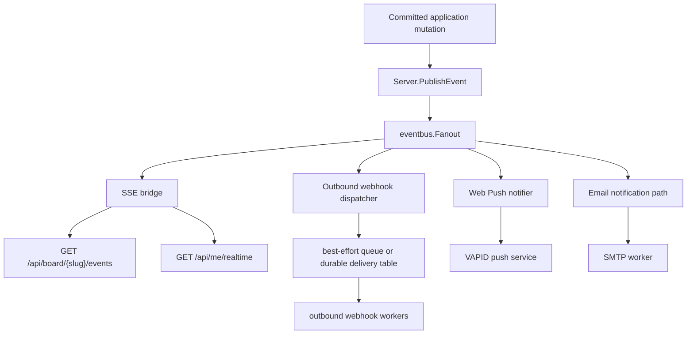
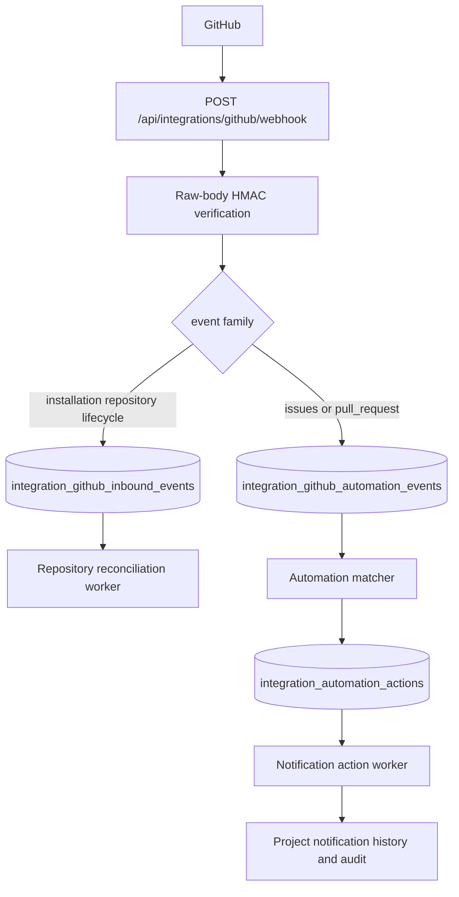

# Realtime and delivery pipelines

Scrumboy has two different event directions that should not be confused:

1. **Scrumboy-originated events** fan out to browsers and optional outbound delivery.
2. **GitHub-originated events** enter through a signed provider webhook and use separate durable inboxes/workers.

## Scrumboy-originated fanout

Prepared todo update/move paths can publish the internal `todo.creator_notification_requested` event. Authorization is rechecked before the private `todo.creator_activity` SSE event or creator email is delivered. Those internal consideration events are not emitted verbatim to browsers or project webhooks.

Wall durable changes produce `wall.refresh_needed`; transient drag/move traffic can use `wall.transient` without a durable store write.

## GitHub-originated inbound flow

The GitHub path does **not** flow through `eventbus.Fanout`. It has independent HMAC admission, dedupe, bounded leases/retries and maintenance. Raw GitHub JSON is not persisted in the durable inboxes; only bounded metadata and SHA-256 digests are stored.

At automation settlement the worker rechecks the rule version, enable/activation time, project/repository association, installation status, repository availability and lease token. Disable/edit/revocation races therefore cancel stale work instead of creating a notification.

## SSE transport

| Client context | Endpoint | Module |
|---|---|---|
| Authenticated user | `GET /api/me/realtime` | `core/realtime.ts` |
| Board stream | `GET /api/board/{slug}/events` | `board-realtime.ts` |
| Public published board | isolated public event route | public-board client |

Both authenticated board paths use the shared SSE client infrastructure.

## Common internal/wire events

| Event | Typical consumer |
|---|---|
| `board.refresh_needed` | board clients |
| `board.members_updated` | membership UI refresh |
| `todo.assigned` | private user stream and push |
| `todo.creator_notification_requested` | internal candidate only |
| `todo.creator_notification_recipient_authorized` | internal authorized candidate |
| `todo.creator_activity` | private user-channel toast |
| `wall.refresh_needed` | Wall refetch/incremental reconciliation |
| `wall.transient` | ephemeral Wall movement |

GitHub automation matches/actions are durable database records rather than ordinary eventbus wire events.
