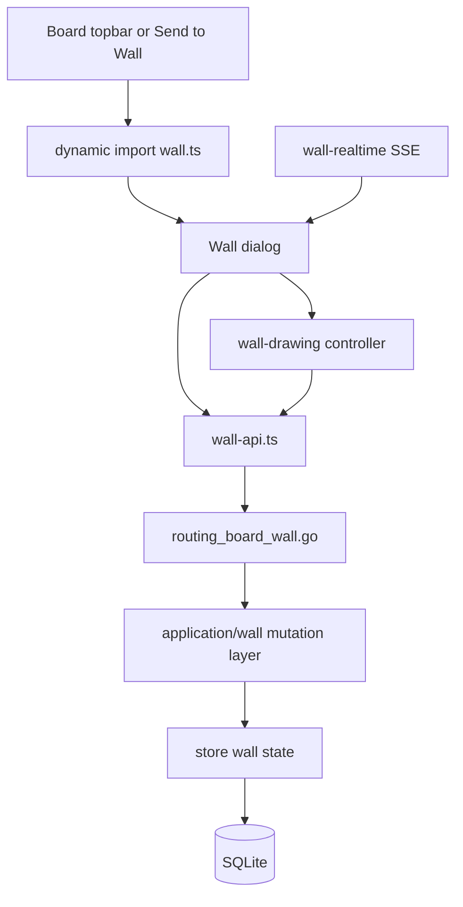
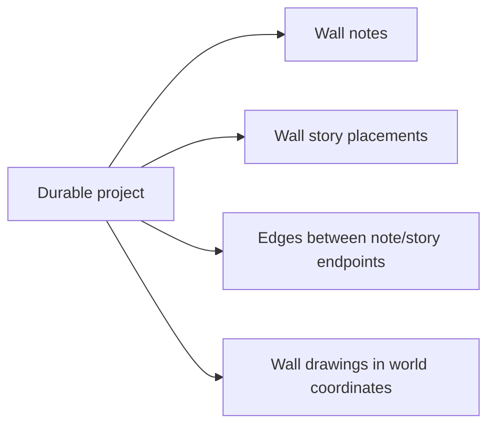
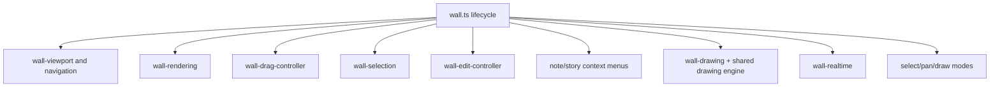
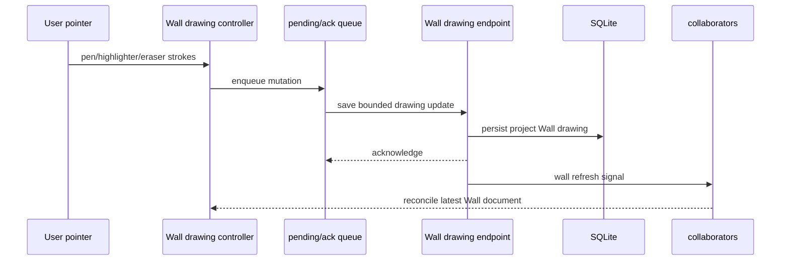

# Wall canvas (Scrumbaby)

The Wall is enabled by default for durable projects and can be disabled instance-wide with `SCRUMBOY_WALL_ENABLED=0`. It is reachable from both desktop and mobile board topbars. Temporary/anonymous boards do not expose the Wall.

The Wall document combines sticky notes, pinned canonical stories, edges, viewport state in the browser, and a persistent drawing layer.

## Content model

Pinned stories are references to canonical Todos, not copies. Moving a story on the Wall changes only its Wall coordinates. Opening it uses the normal story dialog; deleting the Todo removes its placement.

## Frontend composition

Select and Pan are persistent browser interaction modes. Draw mode temporarily takes over pointer input while retaining the same transformed world-coordinate canvas.

## Persistent drawing flow

If drawing work is not safely settled when the Wall closes, the UI warns before discarding unsaved state. Late responses from a previously opened Wall are ignored by lifecycle/current-instance guards.

Viewers can open the Wall read-only. Contributors and Maintainers can mutate Wall content under project authorization. The Wall and its drawing controls remain lazy-loaded so users who never open it do not pay the frontend cost.
